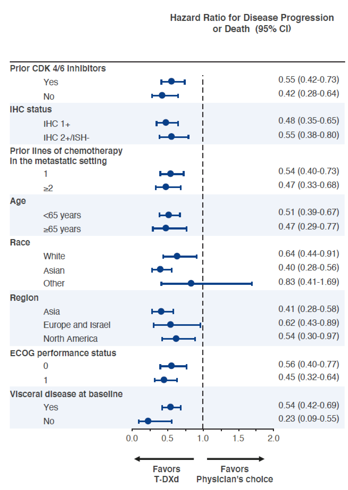

# Code with me - Boucles et Fonctions

On va essayer appliquer ce qu'on a vu dans un exemple pratique

## Initialisation : packages et options

```{r}
#| include: false
Sys.setenv(LANGUAGE="en")

# Sys.setenv(R_LIBCURL_SSL_REVOKE_BEST_EFFORT=TRUE) #parefeu GR
library(tidyverse)
library(flextable)
library(crosstable)
library(glue)

crosstable_options(
  margin=2
)

options(
  ggplot2.discrete.colour = ggsci::scale_colour_lancet, 
  ggplot2.discrete.fill = ggsci::scale_fill_lancet
)
```

## Charger la base de données

Cette base est une simulation visant à reproduire grossièrement les données de l'article. Pour ceux que ça intéresse, je décris le process [ici](https://danchaltiel.github.io/blog/posts/2025-01_20_article_replication/).

Pour l'exemple ici, je simule également une date de progression pour 20% des patients. Il faudra que je l'ajoute dans mon dataset de départ.

```{r}
input = "destiny_breast04.rds"
if(!file.exists(input)){
  download.file("https://github.com/DanChaltiel/blog/raw/refs/heads/main/posts/2025-01_20_article_replication/destiny_breast04.rds", destfile=input)
}

db = readRDS(input)

# View(db)
db %>% select(1:10)
db %>% select(11:last_col())
```

# 1/ Programmation simple

> On va faire l'analyse à l'ancienne

## Table 1

Une petite `crosstable` sur age:visceral_bl, juste pour regarder sur quoi on va bosser.\
Voir la doc sur <https://danchaltiel.github.io/crosstable/>.

```{r}
tbl1 = db %>% 
  crosstable()
tbl1 
```

## Analyse de survie

On recalcule les temps de survie pour la PFS et on génère le Kaplan Meier et le Cox.\
Le package recommandé aujourd'hui est `ggsurvfit` : <https://www.danieldsjoberg.com/ggsurvfit/articles/gallery.html#kmunicate>.

```{r}

db_surv =
  db %>% 
  mutate(
    
  )
 
  
library(survival)
library(ggsurvfit)

fit_pfs = survfit2()
lr_test = survdiff()
km_pfs = ggsurvfit()
km_pfs

cox_pfs = coxph()
cox_pfs
# cox_pfs_chk = cox.zph(cox_pfs) #TODO mais on n'a pas le temps

fit_pfs_val = tidy_survfit()
cox_pfs_val = broom::tidy()
reporting = cli::format_inline(
  "At 3 months, PFS was {fit_pfs_val}. Cox model HR for treatment was {cox_pfs_val}. Unstratified log-rank p = {lr_test}."
)
reporting
```

## Analyse en sous-groupe

Par exemple si on découpe selon `prior_cdki`:

```{r}
db_cdki_list = db_surv %>% split(.$prior_cdki)
db_cdki_list$Yes

cox1 = coxph()
cox2 = coxph()
broom::tidy(cox1, exponentiate=TRUE, conf.int=TRUE)
broom::tidy(cox2, exponentiate=TRUE, conf.int=TRUE)
```

On va ensuite voir comment on peut généraliser pour faire cette figure :

{fig-align="center"}

# 2/ Programmation fonctionnelle

> Allez, on attaque pour de vrai !

## Analyse de survie - programmation fonctionnelle

On va abstractiser tout ça pour avoir une fonction qui fait toute l'analyse.\
La question à se poser c'est : quel input pour quel output?\
Il faut essayer de factoriser au maximum.

```{r}
#input: f = formula
analyse = function(f, data, label){
  
  lst(fit, km, cox, txt)
}

f_pfs = Surv(time_pfs, event_pfs) ~ arm
f_os = Surv(time_os, event_os) ~ arm

analyse_pfs = analyse(f_pfs, data=db_surv, label="PFS")
analyse_os = analyse(f_os, data=db_surv, label="OS")

analyse_pfs$txt
analyse_os$txt
```

On aurait aussi pu prendre en input une valeur texte genre "pfs" et recréer la formule à l'intérieur de la fonction.

## La même, avec une boucle

```{r}
formulas = lst(
  "Overall Survival" = Surv(time_os, event_os) ~ arm,
  "Progression-Free Survival" = Surv(time_pfs, event_pfs) ~ arm,
  "Progression-Free Survival (stratified)" = Surv(time_pfs, event_pfs) ~ arm + 
    strata(race),
)

rslt = NULL

rslt$`Overall Survival`$txt
rslt$`Progression-Free Survival`$txt
rslt$`Progression-Free Survival (stratified)`$txt #il faudrait adapter la fonction pour le KMplot
```

Avantage : on est [**certains**]{.underline} que l'analyse est 100% la même partout.\
Inconvénient : on a centralisé le risque d'erreur

## Analyse en sous-groupe

On a vu plus haut comment on découpe selon `prior_cdki`, maintenant on va automatiser tout ça 😈:

```{r}
get_models = function(x){
  #x="prior_cdki"
  s = db_surv %>% 
    split(.[[x]])
}
#Par exemple : 
# get_models("age")
# get_models("prior_lines")


covariates = c("age", "race", "region", "ecog", "prior_cdki", 
               "prior_lines", "ihc", "visceral_bl")
#Maintenant on applique cette fonction `get_models` à tous les covariates d'un seul coup
rslt_subgp = NULL
rslt_subgp
```

Et on peut enfin faire le graphique :

```{r}
p = ggplot(rslt_subgp)

p
```

# Rapport automatisé

Grand final : on crée un rapport automatisé tout propre !

```{r}

library(officer)

doc = read_docx() %>% 
  body_add_title("Résultats", level=1) %>% 
  body_add_title("Tableau", level=2) %>% 
  body_add_normal("Description de la population") %>% 
  body_add_flextable(tbl1) %>% 
  body_add_break() %>% 
  body_add_title("Analyse de survie", level=2) %>% 
  body_add_normal(rslt$`Progression-Free Survival`$txt) %>% 
  body_add_gg2(rslt$`Progression-Free Survival`$km, width=17, height=17, units="cm") %>% 
  body_add_normal(rslt$`Overall Survival`$txt) %>% 
  body_add_gg2(rslt$`Overall Survival`$km, width=17, height=17, units="cm") %>% 
  body_add_break() %>% 
  body_add_title("Analyses en sous-groupes", level=2) %>% 
  body_add_gg2(p, width=17, height=17, units="cm") 

write_and_open(doc)
```
