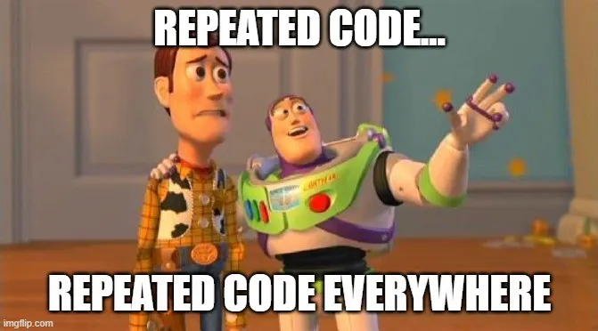

---
format:
  revealjs:
    
    theme: simple
    css: assets/style.css
    pagetitle: "Oncostat R - Boucles"
    output-file: "index.html"
    template-partials:
     - assets/title-slide.html
    include-in-header:
      - text: |
          <script src="assets/coi-serviceworker.min.js"></script>
    title: "Équipe ONCOSTAT <br> Modules de cours de R"
    subtitle: "Programmation fonctionnelle"
    author: "Dan Chaltiel"
    description: "Les boucles et les fonctions"
    incremental: true
    controls: true
    keyboard: true
    code-line-numbers: true
    # embed-resources: true
    scrollable: true
    # number-sections: true
    number-depth: 1
    slide-number: true
    hash: true
    fragmentInURL: true
    smaller: true
    preview-links: auto
    footer: "Le code source de cette présentation est disponible [sur GitHub](https://github.com/Oncostat/rstat_training/){target='_blank'}."
    drop:
      engine: webr
      webr:
        packages:
          - purrr
          - dplyr
execute:
  echo: true
  cache: false
  code-overflow: wrap
  warnings: false
  messages: false
revealjs-plugins:
  - fragoff
  - drop
keywords: ["r", "rstat", "training", "course", "module"]
knitr:
  opts_chunk: 
    collapse: true
    comment: "#>" 
editor: 
  markdown: 
    wrap: 72
editor_options: 
  chunk_output_type: console
---

## Plan du module

1.  Les boucles
2.  Les fonctions

. . .

::: callout-note
Cette présentation est fortement inspirée de l'excellent site
[juba.github.io](https://juba.github.io/tidyverse), en particulier les
chapitres [14](https://juba.github.io/tidyverse/14-fonctions.html)
(fonctions) et [18](https://juba.github.io/tidyverse/18-purrr.html)
(purrr). Allez voir ce site pour en apprendre encore plus!
:::

<!-- https://juba.github.io/tidyverse/18-purrr.html -->

<!-- <https://juba.github.io/tidyverse/14-fonctions.html> -->

```{r}
#| label: init
#| include: false
options(width = 100)
options(crosstable_compact = TRUE)
```

# Les boucles

{fig-align="center"}


## C’est quoi, une boucle ?

-   Répéter le même code sur plusieurs éléments
    ([DRY](https://en.wikipedia.org/wiki/Don%27t_repeat_yourself){.external target="_blank"})
-   Remplacer du copier-coller par une structure générique
-   Améliore la robustesse (toujours)
-   Améliore la lisibilité (parfois)

## Trois grandes façons en R

-   **`for`**
    -   Style impératif, proche des autres langages
    -   Très flexible mais peu lisible, parfois lent
-   **`sapply()`**
    -   Style fonctionnel en base R
    -   Simplification automatique des sorties, parfois piégeuse
-   **`purrr::map()`**
    -   Style fonctionnel `tidyverse`
    -   Type de sortie explicite
    -   S’intègre naturellement dans les pipes et les workflows modernes

## Exemple simple (vecteur) {.no_fragment}

On a un vecteur *character*, et on veut séparer chaque item en
Nom/Prénom

```{r}
#| message: false
#| warning: false
library(tidyverse)
x = c("Jeanne Alyse", "Bertrand Domise", "XXXX", NA)
```

. . .

On va donc utiliser `str_split()` (package `stringr`) dans une boucle.

. . .

::: panel-tabset
#### for

```{r}
res_for = list()
for (i in seq_along(x)) {
  res_for[[i]] = stringr::str_split(x[i], " ")
}
res_for
```

#### sapply

```{r}
res_sapply = sapply(x, function(s) stringr::str_split(s, " "))
res_sapply
```

#### purrr

```{r}
res_purrr = x %>% purrr::map(~ stringr::str_split(.x, " "))
res_purrr
```
:::

## Pour ou contre: les boucles `for`

👎 Contre :

-   Beaucoup de code pour pas grand chose (`5` lignes vs `2`)
-   Plus ou moins lisible selon la complexité
-   Ne s'applique pas en pipeline
-   Déclaration manuelle de l'objet final (souvent mal optimisé)
-   Programmation non-fonctionnelle → Effets de bords !

. . .

👍 Pour :

-   Très flexible
-   Effets de bords ?

## Exemple de boucle `for` *maléfique*

```{r}
res_for = list()
for (i in seq_along(x)) {
  x = stringr::str_split(x[i], " ") #variable temporaire
  res_for[i] = x
}
```

. . .

```{r}
res_for
```

. . .

La ligne `x = str_split(...)` a eu un effet de bord, c'est à dire un
effet hors de sa zone, et ça a écrasé notre vecteur d'origine 😱😭

. . .

Dans une très grande boucle `for`, ce genre de conflit de noms peut
arriver !

## Pour ou contre: `sapply()`

Maintenant, on veut appliquer `table()` à chaque colonne d'une dataframe
:

```{r}
library(crosstable)
x = mtcars2 %>% select(am, vs)
```

. . .

```{r}
sapply(x, table)
```

. . .

```{r}
map(x, table)
```

. . .

Par défaut, `sapply()` simplifie **implicitement** l'output en vecteur
ou en matrice. Comme ici, ça peut donner lieu à des étrangetés.

::: notes
Si l'input change de façon inattendue, ça peut causer des bugs.\
Par exemple, certaines fonctions ne retournent pas la même chose selon
la taille de l'output: vecteur si taille 1 mais matrice si taille \>1,
ou encore une liste de listes...
:::

## `purrr` à la rescousse!

À l'opposé, les fonctions de `purrr` assurent à 100% le type de
l'output:

-   `map()` retourne une liste
-   `map_chr()` retourne un vecteur `character`
-   `map_dbl()` retourne un vecteur `numeric` (double)
-   `map_lgl()` retourne un vecteur `logical`

. . .

Ça donne aussi accès à la syntaxe "lambda-function" : argument par
défaut = `.x`

```{r}
mon_vecteur = 1:5
map_dbl(mon_vecteur, ~.x+1)
map_dbl(mon_vecteur, function(x) x+1)
map_dbl(mon_vecteur, \(x) x+1)  #depuis R 4.1
```

. . .

```{r}
mon_vecteur+1
```

::: notes
On aurait évidemment aussi pu écrire simplement \`mon_vecteur+1\`, on
aurait même gagné plusieurs nano-secondes (mais que faire de tout ce
temps ?), mais je voulais montrer une boucle.
:::

## Quand utiliser des boucles ?

. . .

Sur des fonctions vectorisées, on n'utilise pas de boucles :

```{r}
textes = c("fantastique", "effectivement", "igloo")
str_count(textes, "f")
map_int(textes, ~ str_count(.x, "f")) #moins lisible + moins rapide
```

. . .

On l'utilise sur les fonctions non vectorisées :

```{r}
#| eval: false
fichiers = c("fichier1.csv", "fichier2.csv")
l = fichiers %>% map(read.csv2)
```

. . .

Dans `str_count()`, l'argument `pattern` n'est pas vectorisé :

```{r}
c(a = "a", e = "e") %>% 
  map(~ str_count(textes, pattern = .x))
```

## Oui mais, et les noms ?

Un des "avantages" de `sapply()`, c'est que les noms sont automatiques :

```{r}
x = c("Jeanne Alyse", "Bertrand Domise", "XXXX", NA)
get_prenom = function(s) stringr::str_split(s, " ")[[1]][1]
sapply(x, get_prenom) 
```

. . .

Ca peut poser un problème en cas de noms très longs, donc `map()` ne
prend que les noms explicites :

```{r}
x2 = c("JA"="Jeanne Alyse", BD="Bertrand Domise", XX="Lorem ipsum dolor sit amet, consectetur adipiscing elit, sed do eiusmod tempor incididunt ut labore et dolore magna aliqua", KO=NA)
map_chr(x2, get_prenom) 
```

. . .

::: callout-tip
### Pro tip:

La fonction `set_names()` assigne à un objet des noms basés sur ses
propres valeurs.
:::

```{r}
x %>% set_names()
```

## D'ailleurs, c'est cool les noms, non ?

La fonction `imap()` permet de boucler sur un vecteur (`.x`) et ses noms
(`.y`) en même temps.

. . .

```{r}
mtcars %>% 
  select(1:3) %>% 
  imap_chr(~{
    paste(.y, ":", n_distinct(.x), "valeurs distinctes")
  })
```

. . .

::: callout-note
Notez que boucler sur une dataframe permet d'itérer sur les colonnes en
conservant les noms.
:::

## Parallélisation

A partir de `purrr` v1.1.0, on peut utiliser
[`in_parallel()`](https://purrr.tidyverse.org/reference/in_parallel.html)
pour paralléliser nos fonctions.

::::: columns
::: {.column width="50%"}
```{r}
#| label: parallel
#| cache: true
library(tictoc)
very_long_addition = function(x, y){
  Sys.sleep(0.1) #on attend 0.1 sec
  x+y
}

tic("Sans parallelisation")
a = map_dbl(1:20, ~ very_long_addition(.x, 1))
toc()

```
:::

::: {.column .fragment .incremental width="50%"}
```{r}
#| label: parallel2
#| cache: true
tic("Avec parallelisation")
mirai::daemons(4) #on utilise 4 coeurs

crate = in_parallel(
  ~ very_long_addition(.x, 1), 
  very_long_addition=very_long_addition
)

b = map_dbl(1:20, crate)

mirai::daemons(0)
toc()

```
:::
:::::

. . .

Ici, on double presque notre vitesse, et ce serait encore plus
impressionnant sur plus d'itérations ou une fonction plus longue !

# Les fonctions

{fig-align="center"}

## Principe {style="overflow: hidden;"}

> "En R, tout ce qui existe est un objet, et tout ce qui se passe est
> une fonction."\
> John Chambers

. . .

Une fonction prend des arguments, les transforme, et retourne
un résultat :

. . .

::: panel-tabset
### Function

```{r}
n_events_schoenfeld = function(za, zb, hr){
  x1 = 4*(za+zb)^2
  x2 = log(hr)^2
  rslt = x1/x2
  return(rslt)
}
n_events_schoenfeld(za=1.96, zb=1.28, hr=0.7)
n_events_schoenfeld(za=1.96, zb=1.28, hr=0.6)
```

### Simpler

```{r}
n_events_schoenfeld = function(za, zb, hr){
  x1 = 4*(za+zb)^2
  x2 = log(hr)^2
  x1/x2
}
n_events_schoenfeld(za=1.96, zb=1.28, hr=0.7)
n_events_schoenfeld(za=1.96, zb=1.28, hr=0.6)
```

Par défaut, la dernière ligne vaut `return()` donc on peut simplifier.

### One-line

```{r}
n_events_schoenfeld = function(za, zb, hr){
  4*(za+zb)^2 / (log(hr)^2)
}
n_events_schoenfeld(za=1.96, zb=1.28, hr=0.7)
n_events_schoenfeld(za=1.96, zb=1.28, hr=0.6)
```

On peut toujours faire encore plus court, mais essayez de privilégier la
lisibilité !
:::

. . .

::: callout-note
Une fonction dont le résultat ne dépend que de ses arguments est appelée
une "fonction pure".
:::

## DRY: *Don't repeat yourself*

::::: columns
::: {.column width="50%"}
{fig-align="center"}
:::

::: {.column .incremental width="50%"}
-   Règle générale de programmation

-   Au 3ème copié-collé d'un même bout de code, on se force à faire une
    fonction !

-   On lui donne un nom **explicite**.

-   Ça améliore la lisibilité, la maintenabilité, et la robustesse du
    code.
:::
:::::

## Bonnes pratiques

Comparons deux fonctions :

::::: columns
::: {.column width="50%"}
```{r}
a = 1
very_bad_function = function(x){
  x + a + rnorm(1)
}
very_bad_function(x=1)
a=100
very_bad_function(x=1)
very_bad_function(x=1)
```
:::

::: {.column .fragment width="50%"}
```{r}
add_with_noise = function(x, y, seed=1234){
  set.seed(seed)
  x + y + rnorm(1)
}
add_with_noise(x=1, y=1)
add_with_noise(x=1, y=100)
add_with_noise(x=1, y=100)
```
:::
:::::

. . .

Pourquoi la fonction de gauche est fort vilaine ?

1.  Elle utilise une variable globale, `a`, qui peut changer / ne pas
    exister
2.  Elle n'est pas déterministe / reproductible
3.  Elle a un nom qui ne donne aucune information


## *Wrappers*

Un *wrapper* est une fonction courte qui vise à "réécrire" une fonction
connue pour l'appliquer à un cas particulier.

Exemple de `EDCimport::fct_yesno()` :

```{r}
fct_yesno = function(x){
  x = as.character(x)
  fct_recode(x, "Yes" = "1", "No" = "0")
}
input = c(0,1,0,0)
fct_yesno(input)

```

::: {.callout-tip title="Tip"}
La vraie fonction dans `EDCimport` est bien plus utile, elle gère les
`0/1`, les `TRUE/FALSE`, mais aussi les `Yes/No` encodés, par exemple
`1-Yes/2-No` ou encore les `Oui/Non`.
:::

## L'ellipsis `...`

L'ellipsis (`...`) s'utilise quand on ne sait pas de combien d'arguments on a besoin. \
C'est le cas par exemple avec `dplyr::select()`.

. . .

C'est surtout utile avec les wrappers pour passer des arguments :

```{r}
moyenne = function(v, ...){
  mean(v, ...) #on passe ... à mean()
}
a = c(1:10, NA)
moyenne(a, na.rm=TRUE)
moyenne(a, na.rm=FALSE)
```

. . .

On en a rarement besoin directement, mais on l'utilise avec `c(...)`
ou `list(...)` :

```{r}
f = function(...){
  x = c(...)
  paste(names(x), x, sep=":", collapse=" -- ")
}
f(a="A", b="B", c="C")
f(alpha=0.95, power=0.90, na.rm=TRUE, type="Schoenfeld")
```

## Appel par ordre *vs* Appel par nom

```{r}
moyenne = function(x, remove_missing=TRUE){
  mean(x, na.rm=remove_missing)
}
a = c(1:10, NA)
moyenne(a, TRUE)
moyenne(x=a, remove_missing=TRUE)
moyenne(x=a, remove_missing=FALSE)
```

. . .

En général, on n'appelle pas le 1er argument par nom car peu informatif.

. . .

Certaines fonctions obligent à appeler par nom certains arguments.

. . .

Notez la valeur par défaut de `remove_missing` qui permet d'écrire simplement:

```{r}
moyenne(a)
mean(a)
```

## Erreurs et warnings

Contrairement à SAS, les erreurs R sont **bloquantes** et arrêtent le script : c'est le signe d'un problème majeur qu'il faut corriger.\
Les warnings ne sont pas bloquants.

. . .

On les émet avec `stop()` et `warning()` (base `R`) ou `cli_abort()`et `cli_warn()` (package `cli`).

. . .

::: panel-tabset
### R base

```{r}
#| error: true
#| warning: true

n_events_schoenfeld  = function(za, zb, hr){
  if(za<0) stop("`za` doit être positif!")
  if(zb<0) stop("`zb` doit être positif!")
  if(hr<0 || hr>1) stop("`hr` doit être compris entre 0 et 1!")
  if(za>10) warning("`za` est vraiment très grand, t'es sûr de toi ?")
  4*(za+zb)^2 / (log(hr)^2)
}
n_events_schoenfeld(za=-1.96, zb=1.28, hr=0.7)
n_events_schoenfeld(za=19.6, zb=1.28, hr=0.7)
```

### cli

```{r}
#| error: true
#| warning: true
library(cli)
n_events_schoenfeld  = function(za, zb, hr){
  if(za<0) cli_abort("{.arg za} doit être positif, il vaut {.val {za}}!")
  if(za>10) cli_warn("{.arg za} est vraiment très grand ({.val {za}}), t'es sûr de toi ?")
  4*(za+zb)^2 / (log(hr)^2)
}
n_events_schoenfeld(za=-1.96, zb=1.28, hr=0.7)
n_events_schoenfeld(za=19.6, zb=1.28, hr=0.7)
```

:::

## Side-effects

Certaines fonctions ont une action concrete, par exemple `print()` ou
`write.csv()`.

On appelle ça des "effets de bord".

On a rarement besoin d'en écrire nous-même.

## Exemple final: simulation

On va prendre un exemple un peu compliqué pour revoir tout ce qu'on a
appris !

::: panel-tabset
### `simulate_lm`

```{r}
simulate_lm = function(n, beta=0, sd=1, seed=NULL){
  set.seed(seed)
  data = tibble(
    x = rnorm(n),
    y = beta * x + rnorm(n, sd=sd)
  )
  
  lm(y ~ x, data = data) %>% 
    broom::tidy() %>% 
    filter(term=="x") %>% #on enlève l'intercept
    mutate(args_beta=beta, args_sd=sd)
}
```

```{r}
#| classes: fragment
simulate_lm(n=10000, beta=1) %>% as.data.frame()
```

::: {.callout-warning .fragment}
Attention `set.seed(NULL)` dans une fonction est parfois déconseillé, je ne suis pas expert !
:::

### `run_simulations`

```{r}
#| cache: true
run_simulations = function(N, n, beta = 0, sd = 1){
  tibble(seed = seq_len(N)) %>% 
    mutate(res = map(seed, ~simulate_lm(n=n, beta=beta, sd=sd, seed=.x)))
}
```

<br>

```{r}
#| classes: fragment
run_simulations(N=10, n=10, beta=0) %>% head(2)

run_simulations(N=10, n=10, beta=0) %>% unnest(res) %>% head(2)
```

### `show_results`

```{r}
#| cache: true
show_results = function(sim){
  sim %>% 
    unnest(res) %>% 
    summarise(avg_beta = mean(estimate)) %>% 
    pull(avg_beta)
}
```

<br>

```{r}
#| classes: fragment
run_simulations(N=10, n=10, beta=0) %>% show_results()   #peu précis avec n=10

run_simulations(N=100, n=100, beta=0) %>% show_results() #mieux

run_simulations(N=100, n=100, beta=5) %>% show_results() #mieux aussi
```

:::


## Débuguer avec `browser()` {style="overflow: hidden;"}

Imaginons une fonction qui fait un calcul métier un peu obscur:

```{r}
library(purrr)
f = function(bias, penalty, values){
  ref = mean(values) + bias - penalty
  values %>% 
    map(~{
      data.frame(
        input = .x,
        score = (.x + bias) / (.x - ref)
      )
    }) %>% 
    list_rbind()
}
f(bias=2, penalty=1, values=c(3, 4, 5, 6))
f(bias=1, penalty=1, values=c(2, 4, 6))
```

. . .

Essayons d'ajouter `if(.x - ref == 0) browser()` dans la boucle.

# Conclusion

## Les boucles c'est génial

- Ca réduit la duplication du code (DRY)
- Ca améliore la maintenabilité du code
- Ca améliore (parfois) la lisibilité du code


## Les fonctions c'est génial

- Ca réduit la duplication du code (DRY)
- Ca améliore la maintenabilité du code
- Ca améliore (parfois) la lisibilité du code

::: notes
Maintenabilité : si vous changez d'avis sur un paramètre et que vous avez fait 20 copier-coller, c'est long. Si vous avez fait une fonction/boucle, c'est rapide !
:::

## <!-- MERCI DE VOTRE ATTENTION -->

::::: columns
::: {.column width="60%"}
{fig-align="center"}
:::

::: {.column width="40%"}
{fig-align="center"}
:::
:::::

```{=html}
<script src="assets/custom.js"></script>
```
